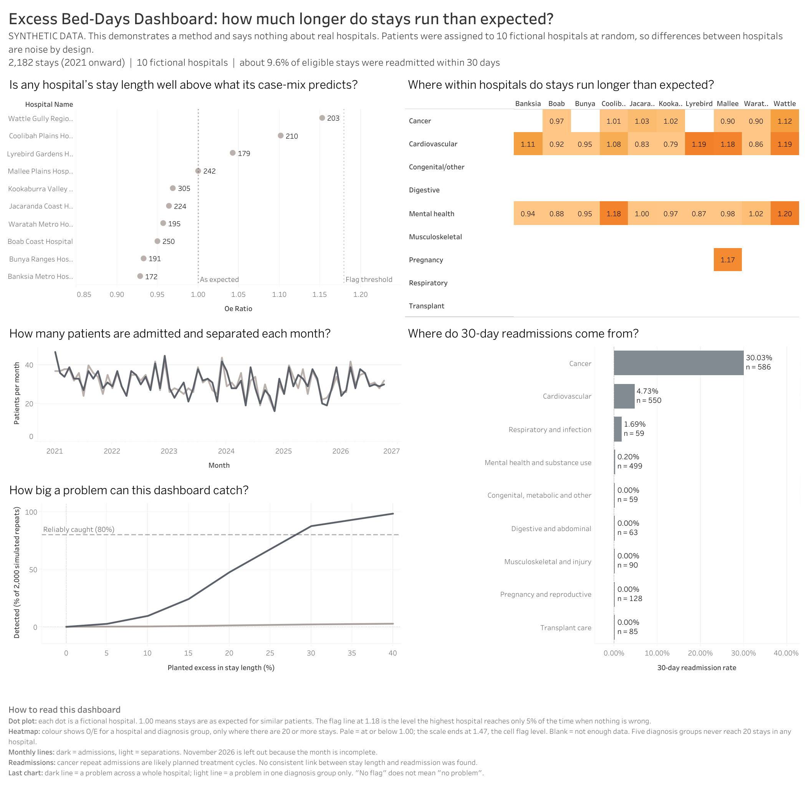

# Excess Bed-Days Dashboard: EMR Analytics

> Synthetic-EMR patient flow dashboard (SQL, Python, Tableau) measuring how much longer patients stay than peers with similar conditions.

**Live dashboard:** [Tableau Public](https://public.tableau.com/app/profile/dreshti.kandpal/viz/ExcessBed-DaysDashboardsyntheticdata/Dashboard1)

> **Synthetic data.** This project demonstrates a *method*. It says nothing about real hospitals. Patients are assigned to 10 fictional hospitals at random, so differences between hospitals are noise by design.

## The healthcare problem
An average length of stay hides a lot: a cardiac ward may stay longer simply because its patients are sicker. A fairer question is **"is this stay longer than expected for patients like this one?"** In an electronic medical record such as Queensland's ieMR, a patient's length of stay is visible, but whether it is longer than expected for their condition is not. This project adds that comparison and, importantly, tests whether the comparison can actually detect a problem. See [`docs/clinical_context.md`](docs/clinical_context.md).

## What it does
1. Generates synthetic patients (Synthea) and re-labels them with Australian hospital terms (fictional hospitals, separation, remoteness).
2. Computes, for every stay, the **expected length of stay** from its peers (same diagnosis group and age band, leave-one-out) and the **O/E ratio** (observed / expected).
3. Flags 30-day readmissions (excluding same-day continuations, deaths and incomplete follow-up).
4. **Validates itself:** plants a known excess in one hospital and measures how often the index detects it.
5. Presents five charts on one Tableau Public dashboard.

## Key results (synthetic data, so a demonstration, not findings)
- **2,182 stays** (2021 onward), 10 fictional hospitals. No hospital exceeds the flag line (highest O/E 1.15, flag at 1.18), as expected when assignment is random.
- **Detection power:** a hospital-wide excess needs roughly **+28%** to be caught reliably; an excess confined to one diagnosis group is almost never caught at hospital level (3% at +40%). So "no flag" does not mean "no problem".
- **Readmissions:** about 9.6% overall, 86% of them in cancer (likely planned treatment cycles). No consistent link between stay length and readmission.

## The dashboard
[](https://public.tableau.com/app/profile/dreshti.kandpal/viz/ExcessBed-DaysDashboardsyntheticdata/Dashboard1)

*Click the image to open the live dashboard on Tableau Public.*

| Chart | Question |
|---|---|
| 1. Hospital O/E dot plot | Is any hospital well above what its case-mix predicts? |
| 2. Hospital x diagnosis heatmap | Where within hospitals do stays run longer than expected? |
| 3. Monthly admissions and separations | How busy is each month? |
| 4. Readmissions by diagnosis group | Where do 30-day readmissions come from? |
| 5. Planted-excess detection | How big a problem can this dashboard catch? |

Design rules: one screen, no tabs, few controls, one accent colour, and every number shows how many stays it rests on.

## Method choices (and why)
Details in [`docs/metric_definitions.md`](docs/metric_definitions.md) and [`docs/how_it_works.md`](docs/how_it_works.md).
- **Mean, not median**, as the benchmark (stay lengths are skewed; a median makes almost every group look like it has excess days).
- **Leave-one-out**: a stay does not help set its own benchmark.
- **O/E ratio** (observed / expected), a standard benchmarking form.
- **Minimum 10 stays per peer group** (20 per hospital x diagnosis cell), otherwise not scored.
- **Planted-excess test** to calibrate the flag lines (1.18 for hospitals, 1.47 for cells).

## Data, privacy and ethics
- **All data is synthetic** ([Synthea](https://synthetichealth.github.io/synthea/)) with a fictional hospital layer. No real patient data is used or included.
- Names, SSN, addresses and race/ethnicity are not carried into the analysis. Race categories follow US census groups and cannot honestly be translated to Aboriginal and Torres Strait Islander status.
- Synthea is US-modelled, so the clinical content is not Australian. Only the labels and structure are.
- Raw data is not committed; small processed tables in `data/processed/` are.

## Limitations
- Peers use diagnosis group and age only (no severity, comorbidity or sex).
- Hospital differences are random by design.
- Planned and unplanned readmissions cannot be separated in synthetic data.
- Only 2,182 stays, so cells are small.
- The method is my own design based on common benchmarking ideas; official definitions have **not yet been checked** (see [`docs/TODO.md`](docs/TODO.md)).

## Repo structure
| Folder | Purpose |
|---|---|
| `sql/` | Numbered SQL: expected length of stay, readmissions |
| `src/` | Data build, SQL runner, export and the planted-excess test |
| `data/processed/` | Small cleaned tables used by Tableau |
| `data/mappings/` | Fictional hospitals and diagnosis groups |
| `tableau/` | Dashboard screenshot and link |
| `docs/` | Clinical context, metric definitions, ethics, teaching guide, build plan |

## How to reproduce
Requires Python 3.10+ and Java (for Synthea).
```bash
pip install -r requirements.txt
cp .env.example .env
```
1. Generate synthetic data (seed 42, 8,000 patients; the Synthea jar is downloaded from its GitHub releases):
```bash
java -jar synthea-with-dependencies.jar -s 42 -p 8000 --exporter.csv.export=true --exporter.fhir.export=false --exporter.csv.included_files=patients.csv,encounters.csv,conditions.csv,organizations.csv,providers.csv --exporter.baseDirectory=./synthea_out
```
2. Copy the five CSVs from `synthea_out/csv/` into `data/raw/`.
3. Run the pipeline:
```bash
python src/australianise.py
python src/run_sql.py sql/01_expected_los.sql
python src/run_sql.py sql/02_readmissions.sql
python src/export_tables.py
python src/planted_excess_test.py
```
Note: the Synthea jar is the latest release, so exact numbers may differ from the published dashboard if Synthea changes.

## Licence
MIT, see [LICENSE](LICENSE).
